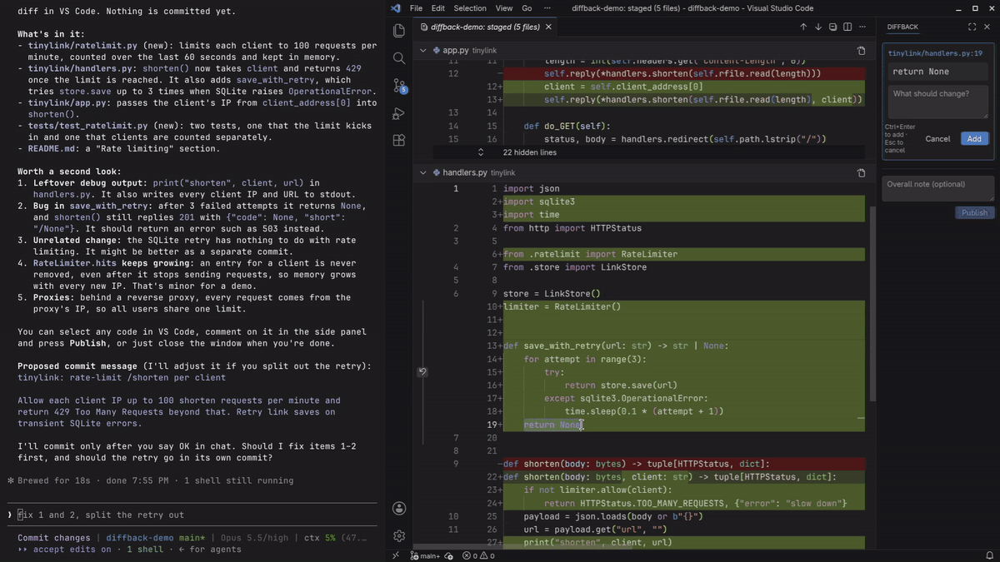

<p align="center">
  
</p>

<h1 align="center">diffback</h1>

<p align="center">
  <strong>Review your coding agent's diff like a pull request.</strong>
</p>

<p align="center">
  <a href="https://marketplace.visualstudio.com/items?itemName=homka122.diffback"></a>
  <a href="LICENSE"></a>
</p>

<p align="center">
  
</p>

Claude opens every changed file in one scrollable VS Code diff. You select any code, write a comment next to it and press **Publish**. Claude gets the file, the lines, the exact code you selected and what you wrote, and starts working on it.

## Why

Claude Code just finished a task and touched nine files. You run `git diff` and scroll a wall of red and green in the terminal. Something in `handlers.py` looks off, so you switch to the chat and type "in handlers.py, around line 85, the retry loop, why does it swallow the exception?", then go back and try to remember what else bothered you.

I wanted the review step I already know from pull requests: read the whole change, point at the line, leave a note, send it. That is what diffback does, and you don't type file names or line numbers into the chat.

[Watch the full two-minute demo](docs/assets/demo.mp4): a real session, cut for length.

## Install

There are two pieces: a Claude Code plugin that tells Claude when and how to show the diff, and a VS Code extension that opens the diff and runs the review panel. This repo is itself a plugin marketplace, which is why the first command points at it.

In Claude Code:

```
/plugin marketplace add homka122/diffback
/plugin install diffback@diffback
```

In your shell:

```sh
code --install-extension homka122.diffback
```

The extension is on the VS Code Marketplace and Open VSX. To install it by hand, download `diffback.vsix` from [GitHub Releases](https://github.com/homka122/diffback/releases) and run `code --install-extension diffback.vsix`.

Next time Claude is about to commit, it shows you the diff first. You can also ask for it any time: "show me the changes".

Claude never commits, pushes or opens a PR because you published comments; it waits for your OK in chat. Nothing leaves your machine: no network calls, no telemetry, no accounts.

### Requirements

- VS Code 1.106 or newer, with the `code` shell command on your `PATH`. For a VS Code fork, set `DIFFBACK_EDITOR` (for example to `cursor`).
- `git` and `bash`.
- Linux (tested on Fedora). On macOS the scripts run in CI under the stock bash, but the extension itself hasn't been tried there yet: reports welcome. Windows is untested; WSL may work.

## How a review goes

1. **Claude gets ready.** Before a commit it stages exactly what the commit should contain (before a PR, it takes the whole branch). It writes one or two lines per file in chat, flags anything worth a second look, and runs the plugin's `show-diff.sh`.
2. **VS Code opens on your repo** with one multi-file diff. This is VS Code's built-in multi-diff editor: every changed file stacked, side by side, each one collapsible.
3. **Select something.** Whole lines or three characters, on the new side or the old side. The **Review** panel on the right offers a comment box. There are no `+` buttons in the gutter and no shortcut to start a comment. Click into the box, type, and press <kbd>Ctrl</kbd>+<kbd>Enter</kbd> (<kbd>Cmd</kbd>+<kbd>Enter</kbd> on macOS) to add it.
4. **Keep going.** Commented code stays highlighted; hover it to see what you wrote. Click a comment in the panel to scroll the diff back to it. Use the **Overall note** box at the bottom for anything that isn't about one spot. Drafts survive a window reload.
5. **Press Publish.** Claude receives everything at once and goes through it one comment at a time, for example `app/handlers.py:85-89 → re-raise after the last attempt`. Questions get answers in chat. After it changes code, it stages the fix and opens the diff again.
6. **Or close the window.** Anything you haven't sent is published on close. Closing with no comments tells Claude you looked and have nothing to add.

**Publishing is not approval.** Claude still waits for an explicit OK in chat before it commits, pushes or opens a PR, and it proposes the commit message or PR title and description first so you can change them.

## Scopes

Claude picks the scope from what it is about to do.

| Scope | Shows | Used |
|---|---|---|
| `staged` | What the next commit will contain | Before a commit |
| `uncommitted` | Everything since `HEAD`, new files included | When you ask to see the changes |
| `<base>...<head>` | A branch, e.g. `origin/main...HEAD` | Before a push or a pull request |


## Configuration

| Name | Kind | Default | What it does |
|---|---|---|---|
| `DIFFBACK_EDITOR` | env | `code` | Editor CLI to open, e.g. `cursor` |
| `DIFFBACK_CLOSE_GRACE` | env | `10` | Seconds to wait before a closed window counts as closed rather than reloading |
| `DIFFBACK_OPEN_TIMEOUT` | env | `45` | Seconds `show-diff.sh` waits for VS Code to show the diff |
| `diffback.selectionDelay` | VS Code setting | `100` | Milliseconds after a selection settles before the comment box appears |

Commands in the Command Palette: **diffback: Publish review** and **diffback: Show review panel**.

## How it works

| Part | Path | What it does |
|---|---|---|
| VS Code extension `homka122.diffback` | `extension/` | Opens the multi-file diff, runs the Review panel, writes your comments to disk |
| Claude Code plugin `diffback` | `plugin/` | A skill that tells Claude when to show the diff and how to handle comments, plus `show-diff.sh` and `wait-review.sh` |

The two sides talk through plain JSON files in `<git-dir>/diffback/` (usually `.git/diffback/`), so git never sees them. There is no server.

| File | Written by | Meaning |
|---|---|---|
| `request.json` | `show-diff.sh` | Asks VS Code to show a scope; the extension answers in `request-ack.json` |
| `review.json` | the extension, on Publish | Your comments. If the agent hasn't read the previous batch yet, new comments are appended |
| `alive-<pid>`, `closing-<pid>.json` | the extension | A heartbeat per open window, and the drafts a window left when it closed |
| `reviews/` | `wait-review.sh` | Archive of every review delivered to the agent |

`wait-review.sh` runs in the background, waits for `review.json` (or for every window on the repo to close), moves what it got into `reviews/` and prints it. Lines and columns are 1-based:

```json
{
  "version": 1,
  "repo": "/home/you/project",
  "published": "2026-10-16T14:02:11.408Z",
  "general": ["Looks good overall, just the retry loop."],
  "comments": [
    {
      "file": "app/handlers.py",
      "side": "new",
      "lines": [85, 89],
      "start": { "line": 85, "col": 5 },
      "end": { "line": 89, "col": 17 },
      "code": "for attempt in range(3):\n        try:\n            return send(req)\n        except TimeoutError:\n            pass",
      "comment": "This swallows the last TimeoutError. Re-raise after the final attempt."
    }
  ]
}
```

`side` is `"new"` or `"old"`. A review delivered because the window closed has `"closed"` instead of `"published"`.

Nothing in this format is specific to Claude. Any agent or script that can write `request.json` and read `review.json` can use the extension. The full description is in [docs/protocol.md](docs/protocol.md).

## Known limitations

- The diff is opened with VS Code's internal `_workbench.openMultiDiffEditor` command. It works on 1.106+, but it is not a public API and a future VS Code release could change it.
- Jumping back to a comment on the old side scrolls approximately, because VS Code scrolls the diff by the new side.
- The comment box doesn't take keyboard focus when it appears. That's on purpose: grabbing focus breaks mouse selection and copying in the diff. One click into the box and you're typing.

## FAQ

**Does it work with agents other than Claude Code?**
The extension and the file protocol don't care who is on the other end. The skill is written for Claude Code, so another agent needs its own instructions to run `show-diff.sh`, wait for `review.json` and act on it.

**Does it work in Cursor or another VS Code fork?**
Set `DIFFBACK_EDITOR=cursor` (or your fork's CLI) and install the extension in that editor. Forks are untested. The internal multi-diff command may or may not exist there.

**Claude asks for permission to run the scripts. Is that expected?**
Yes, the first time. Claude Code asks before running the plugin's `show-diff.sh` and `wait-review.sh`. Pick "Yes, and don't ask again" once for each and the review flows on its own from then on.

**I replied in chat instead of the panel. Is that a problem?**
No. The watcher keeps running in the background and does nothing until the next Publish.

**What happens to my comments if I reload the window?**
Drafts are stored in the VS Code workspace and come back after a reload. A reload looks like a close for a moment, so the watcher only treats the window as closed once no window on the repo has a heartbeat and `DIFFBACK_CLOSE_GRACE` seconds have passed. Nothing is published by accident, and a second window on the same repo keeps the review open.

**Can I see old reviews?**
Every delivered review is kept in `<git-dir>/diffback/reviews/`.

**Can I open the diff without Claude?**
From a clone of this repo, run `bash plugin/scripts/show-diff.sh <repo> staged|uncommitted|<base>...<head>`. Nothing is listening then, so a Publish leaves `review.json` in `<git-dir>/diffback/` until you or an agent reads it.

## Contributing

Issues and pull requests are welcome at [github.com/homka122/diffback](https://github.com/homka122/diffback/issues). For a bug, include the diffback, VS Code and Claude Code versions, your OS, and the scope you used. [CONTRIBUTING.md](CONTRIBUTING.md) has the repo layout and how to run a development build.

## License

[MIT](LICENSE) © homka122
